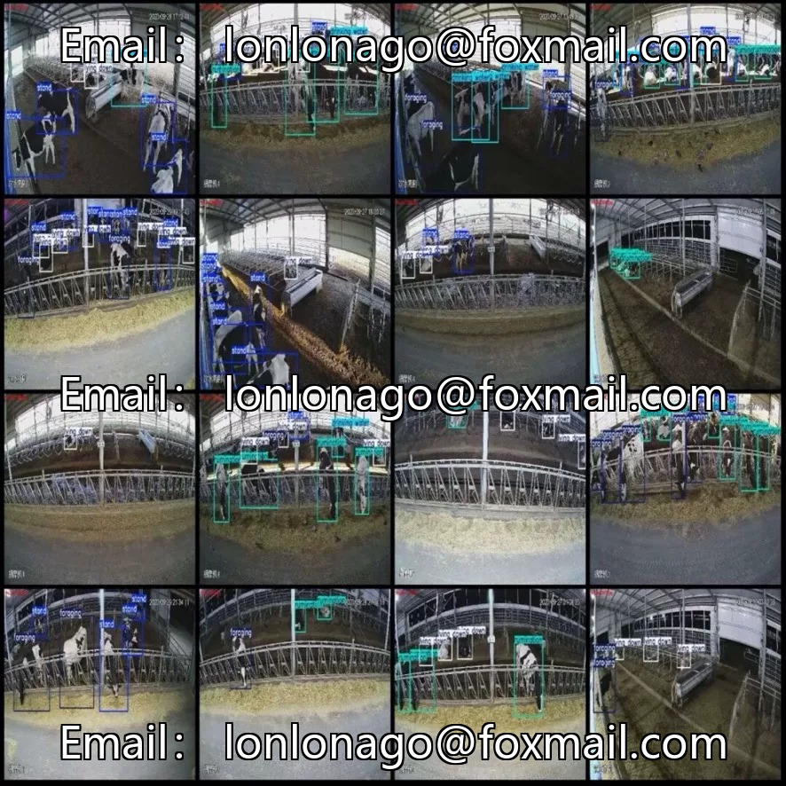
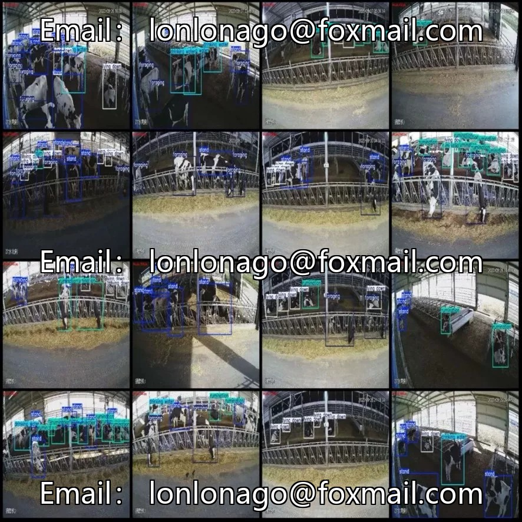
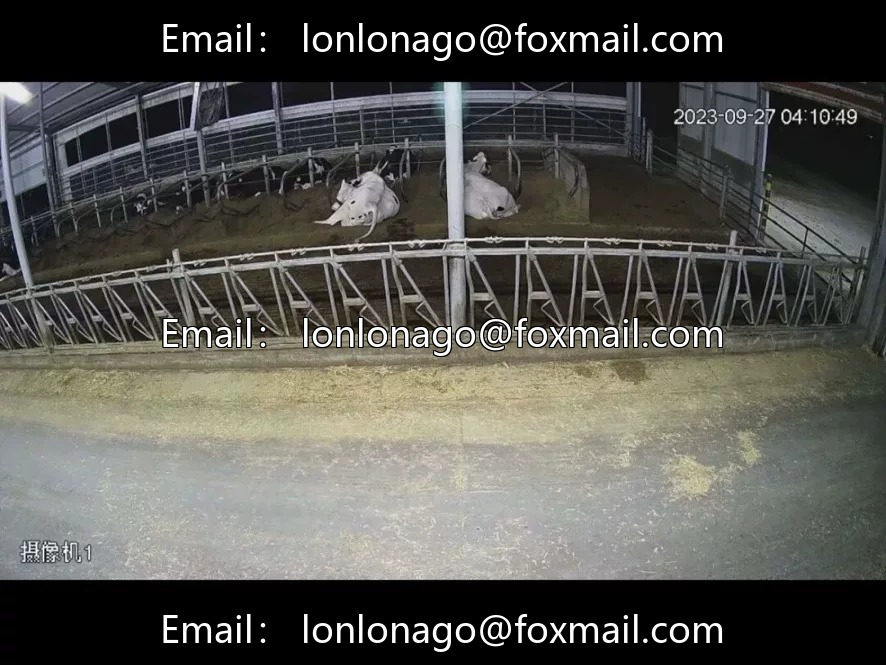

# High-definition dataset for bovine behavior detection

## Body

High-definition dataset for bovine behavior detection in farms, comprising 3198 high-resolution images (1920×1080) of 5 types of behaviors: drinking water, foraging, lying down, rumination, standing. Total labeled bounding boxes are 25,300, with an average of 8 cattle per image, offering a high density suitable for training target detection algorithms and intelligent farming scenarios.

Behavioral distribution: Standing is the most common (8357 frames), drinking water is the least (717 frames), and samples of rumination and lying are abundant (over 6000+/4500+), which are important in health monitoring. Scenes of different time periods with camera screenshots, rich lighting conditions, fixed background of the cattle shed, densely crowded cattle that obscure much, pose challenges to detection algorithms. High resolution, good retention of bovine body details, which is conducive to distinguishing between standing/lying postures.

The dataset is not divided into training/validation/test sets; divide it according to 8:1:1 yourself.

Virtual materials, once sold, are non-refundable.
Interested friends, click "I want" to proceed.

## Images

## Payment

Here is a pay link on Stripe ( https://buy.stripe.com/3cs8yP7sY87d0vu9AB ). Please contact me lonlonago@foxmail.com after funding $89, and I will send you a complete data files , thank you!

